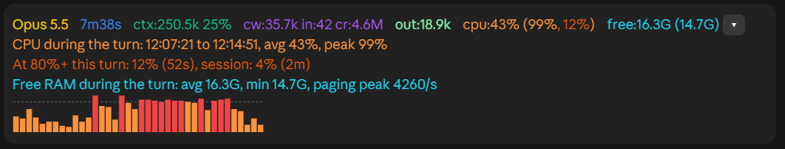

# claude-mods

Mods for Claude Code, installable as a marketplace.

| Mod | What it does |
| --- | --- |
| [turn-monitor](mods/turn-monitor) | Shows each finished turn's time, tokens, context fill and CPU load in a band above the prompt, and keeps a per-turn log. Windows for CPU and the log. |




## Install

In a terminal Claude Code session:

```
/plugin install turn-monitor --marketplace SentientNr6/claude-mods
```

Answer `y` to add the marketplace and pick the user scope. Each mod has its own
README with what it writes and what it needs.

## Adding a mod

Put it in `mods/<name>/` with its own `.claude-plugin/plugin.json`, then add an
entry to `.claude-plugin/marketplace.json`:

```json
{ "name": "<name>", "source": "./mods/<name>" }
```

## Licence

MIT, see [LICENSE](LICENSE).
