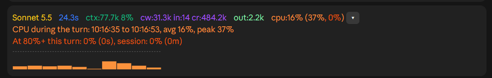

# turn-monitor

A Claude Code mod that shows how each finished turn went: how long it took,
how much of the context window is used, the token counts, and how busy the CPU
was while it ran. It can also keep a per-turn log, so you can see after a week
how often your machine was the bottleneck.

## What it shows

A band above the prompt, updated when a turn finishes. Here with the CPU card
expanded:



| Group | Meaning |
| --- | --- |
| model | the model that answered |
| time | wall time of the turn (`48.5s`, `1m5s`, `1h2m5s`) |
| `ctx` | tokens in the context window and its fill; red with `!!!` from 80% |
| `cw in cr` | tokens written to the cache, uncached input, read from the cache |
| `out` | output tokens |
| `cpu` | average, peak, and share of samples at 80% or more during the turn (only for turns over 20 s) |
| `▸` | expands a card with a bar graph of the turn's CPU load |

Each finished turn also appends the same figures as one plain line to the
transcript.

## The turn log

Every finished turn (subagents excluded) appends one JSON line to
`~/.claude/turn-monitor/log-YYYY-MM.jsonl`:

- `ts`, `session_id`, `session_title`, `project`, `model`, `reason`
- `duration_ms`, `tool_ms`, `tool_calls`, `model_ms` (the turn's wall time split
  into time inside tool calls and the rest; overlapping calls count once)
- `samples`, `cpu_avg`, `cpu_peak`, `hot_ms` (time at 80% or more),
  `queue_avg`, `queue_peak`
- `tool_samples`, `tool_cpu_avg`, `tool_cpu_peak`, `tool_hot_ms`,
  `tool_queue_avg`, `tool_queue_peak` (the same, only while tools ran)
- `cores`
- `input_tokens`, `output_tokens`, `cache_read_tokens`, `cache_write_tokens`

A turn is probably CPU-bound when much of it is tool time, the CPU was hot
during that tool time, and the processor queue stayed above about twice the
core count.

The file stays on your machine; the mod makes no network requests.

## Install

In a terminal Claude Code session:

```
/plugin install turn-monitor --marketplace SentientNr6/claude-mods
```

Answer `y` to add the marketplace and pick the user scope. For a local checkout,
run `claude --plugin-dir <this folder>`.

## Requirements and limits

- **Windows for CPU and the log.** CPU load and processor queue length come from
  `typeperf` (one long-running process, a sample every 2 seconds), and the log
  path is built from `USERPROFILE`. On macOS or Linux the band still shows
  model, time, context and tokens, but there is no CPU group and no log.
- CPU load is the whole machine's, not Claude's own share.
- The session title is read from the file the engine keeps beside the
  session's transcript under `~/.claude/projects/`.
- The band is drawn on the terminal and desktop surfaces. The expandable CPU
  graph needs a surface with SVG (desktop); the terminal shows the text only.

## Settings

Colours, the 20 s CPU threshold, the sample interval and the 80% limit are
constants at the top of `hooks/register.tsx`.

## Licence

MIT
